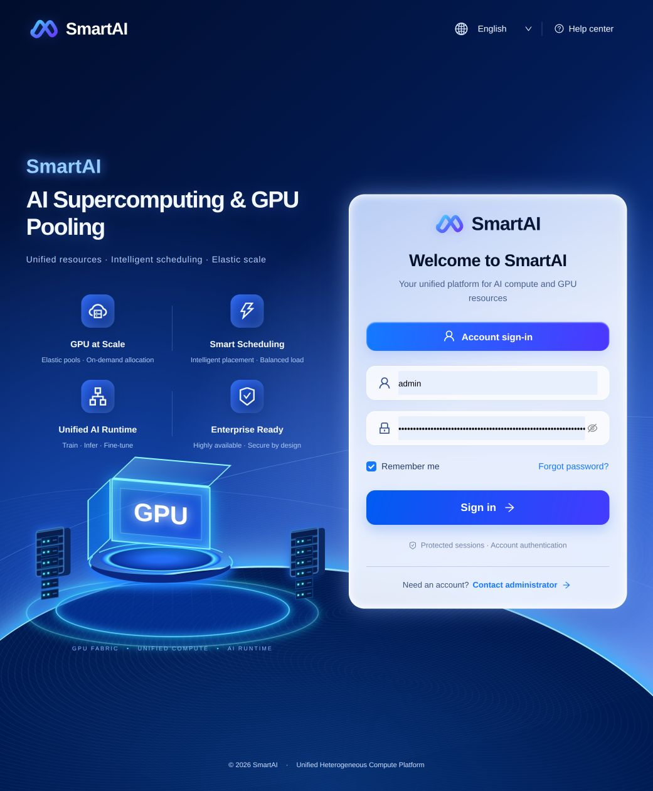
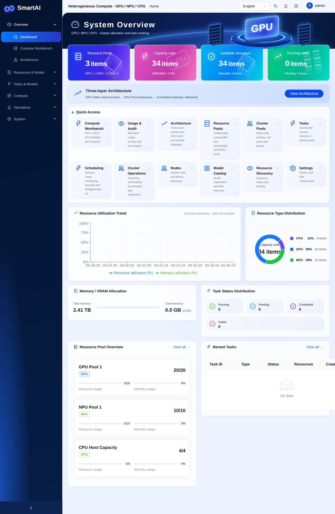

# SmartAI

### Unified Heterogeneous Compute Management Platform

SmartAI brings GPU, NPU, and CPU resources into one management platform for AI workloads. It combines resource pooling, scheduling, monitoring, and a bilingual web console to help teams organize shared compute capacity for training and inference.

The project builds on GPU and Ascend virtualization components originally developed by [ModelEngine-Group](https://github.com/ModelEngine-Group). SmartAI adds a unified management experience while retaining the original component directories and attribution.

> **Project status: early-stage incubation.** The local application includes example nodes, simulated telemetry, and an allocation ledger. Real workload execution requires integration with cluster executors, device services, and the target infrastructure. “Incubation” describes this project's development stage; it does not imply membership in a foundation or incubation program.

## Product Preview

### Account Sign-in

Start with a branded English sign-in page that introduces resource pooling and scheduling alongside the administrator login. The language selector also supports Simplified Chinese.

[](docs/images/smartai-login.jpg)

*Account access: a dedicated login screen for entering the compute management console.*

### Home Dashboard

See GPU, NPU, and CPU capacity in one view. The homepage brings together resource availability, running tasks, utilization trends, memory allocation, and resource pool details, with shortcuts to scheduling, cluster operations, and usage auditing.

[](docs/images/smartai-dashboard.jpg)

*From capacity to action: inspect shared resources, then open the workbench or scheduling tools from the same dashboard. Click either screenshot to view it at full size.*

*Screenshots show the running local application with example resources and simulated telemetry. They illustrate the current interface, rather than production workload results.*

## Why SmartAI?

AI teams often run large models, smaller inference services, and development workloads on the same infrastructure. Dedicated accelerators can sit underused while other tasks wait for capacity. SmartAI provides a shared control plane to inspect capacity, define team queues, and request resources across different compute types.

## Key Capabilities

- **Unified resource management:** manage GPU/NPU pools, CPU capacity, cluster nodes, and resource discovery.
- **Scheduling and orchestration:** priority queues, quotas, Gang scheduling, placement policies, preflight checks, and multi-node/domain constraints.
- **Observability and operations:** resource dashboards, device telemetry, operational events, diagnostics, and benchmark workflows.
- **Usage and governance:** allocation usage, administrative audit records, and exportable reports.
- **AI workload organization:** model catalog, projects, and training/inference task management.
- **Web console and account sign-in:** English by default, Simplified Chinese support, and local administrator authentication with server-side sessions.
- **Virtualization components:** existing GPU and Ascend NPU services for hardware-specific integration; compatibility and deployment requirements vary by component.

## Architecture

```text
                 SmartAI Web Console
                  English / Chinese
                         |
                REST API + Account Sessions
                         |
       +-----------------+------------------+
       |                 |                  |
 Resource Pools    Scheduler & Queues   Usage & Operations
       |                 |                  |
       +-----------------+------------------+
                         |
          GPU / Ascend NPU / CPU Resources
          Device Services & Cluster Integration
```

## Quick Start

**Requirements:** Go 1.21+, Node.js 18+, and npm. The local control-plane demo does not require accelerator hardware. Hardware virtualization and real workload execution have additional requirements documented in their respective modules.

### 1. Start the backend

From the repository root:

```bash
cd unified-resource-manager
go run ./cmd -data-dir ./data/governance
```

The API listens on `http://localhost:8080/api/v1`.

On first startup, a local **admin** account is created. Its generated password is saved in:

```text
unified-resource-manager/data/governance/initial-admin-password
```

Read that file locally to sign in. Credentials persist across restarts; active sessions do not. Keep runtime data and credentials out of Git. See [account setup and deployment notes](unified-resource-manager/docs/account-login/README.md) for configuration and password recovery.

### 2. Start the web console

In a second terminal, from the repository root:

```bash
cd unified-resource-manager/web/frontend
npm ci
npm run dev -- --port 3010 --strictPort
```

Open **[http://localhost:3010](http://localhost:3010)** and sign in with the administrator account. The frontend proxies API requests to `http://127.0.0.1:8080`; set `VITE_PROXY_TARGET` to use a different backend.

### 3. Explore

1. Review the dashboard and registered nodes.
2. Open Compute Workbench to inspect capacity and request resources.
3. Use Scheduling to inspect team queues and quotas.
4. Check Tasks, Metrics, and Usage & Audit to follow allocations.

Local allocations and simulated telemetry demonstrate the control plane. They do not confirm that a container or training job ran on physical hardware. The current account implementation supports one local administrator; SSO, third-party sign-in, and self-service registration are not configured.

## Repository Layout

| Directory | Purpose |
| --- | --- |
| [`unified-resource-manager/`](unified-resource-manager/) | Go control plane, REST APIs, scheduler, governance, and operations |
| [`unified-resource-manager/web/frontend/`](unified-resource-manager/web/frontend/) | React, TypeScript, Vite, and Ant Design console |
| [`GPU-Virtual-Service/`](GPU-Virtual-Service/) | Original GPU virtualization components |
| [`Ascend-Virtual-Service/`](Ascend-Virtual-Service/) | Original Ascend NPU virtualization components |
| [`docs/`](docs/) | Project-level documentation and GitHub publishing guide |

## Development

```bash
# Backend tests (from unified-resource-manager/)
go test ./...

# Frontend checks (from unified-resource-manager/web/frontend/)
npm run test:i18n
npm run build
```

## Incubation Priorities

- Validate real cluster execution and hardware integrations.
- Expand compatibility testing across accelerator types and deployment environments.
- Improve account lifecycle management and enterprise identity integration.
- Strengthen deployment automation, documentation, and contributor workflows.

These are development priorities, not delivery commitments.

## Contributing

Bug reports, documentation improvements, compatibility results, and focused pull requests are welcome. Include reproduction steps and environment details for issues; describe behavior changes and validation results in pull requests. Keep credentials, private datasets, and runtime records out of contributions.

For publishing your own GitHub repository and maintaining it, see the [GitHub upload and maintenance guide (中文)](docs/GITHUB_GUIDE.zh-CN.md).

## Attribution and Licensing

SmartAI includes components originally developed by ModelEngine-Group. Existing copyright notices and third-party component terms must be preserved. A repository-wide license has not yet been established in this checkout. Confirm the applicable upstream and bundled-binary permissions before public redistribution; this README does not grant additional license rights.
